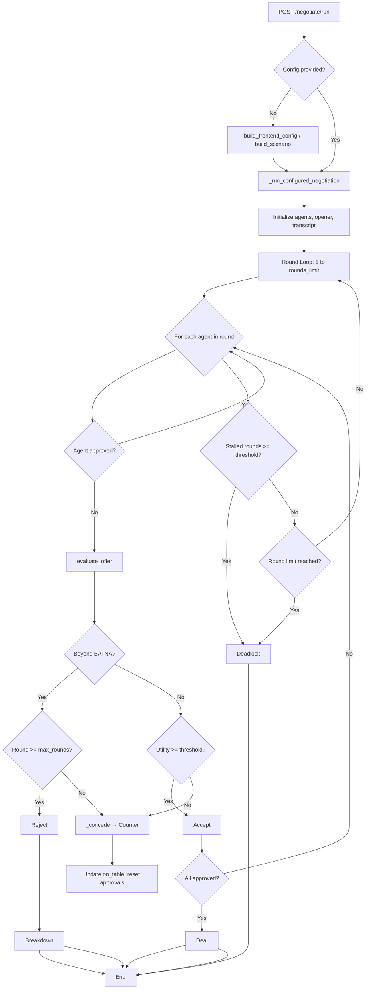

# Phase 2 Task 1 — Negotiation Engine Audit

**Date:** 2026-11-22  
**Author:** Senior Software Architect & Python Backend Engineer  
**Status:** Audit Only — No Implementation

---

## 1. Current Agent Architecture

### 1.1 Agent Types

| Type | Location | Purpose |
|------|----------|---------|
| `NegotiationParty` | `backend/app/models.py:54` | API configuration model (request-time) |
| `AgentProfile` | `backend/app/models.py:182` | Internal engine model (runtime) |
| `Agent` | `frontend/src/engine/types.ts:242` | Frontend engine type (runtime) |

### 1.2 AgentProfile Fields

```python
class AgentProfile(BaseModel):
    id: str                          # Unique identifier
    role: str                        # Human-readable role (e.g., "Supplier")
    personality: Literal["aggressive", "collaborative", "risk_averse"]
    skill: Literal["novice", "skilled", "expert"] = "skilled"
    wants_higher_price: bool         # True for sellers, False for buyers
    target: Terms                    # Ideal deal (all scenario fields)
    batna: Terms                     # Walk-away limits (BATNA)
    weights: dict = {...}            # Issue importance weights
```

### 1.3 Key Observations

- **Dual model hierarchy**: `NegotiationParty` (API) → `AgentProfile` (engine) via `build_configured_agents()`
- Conversion uses `IssueTermField` mapping (canonical IDs → `Terms` fields)
- `wants_higher_price` determined heuristically: compares `target.price` vs `walk_away.price` (or `salary`)

---

## 2. Utility Calculation

### 2.1 Core Function

**Location**: `backend/app/evaluation.py:43-67`

```python
def utility(agent: AgentProfile, offer: Terms, issues: list[NegotiationIssue] | None = None) -> float:
    if issues is not None:
        score = 0.0
        for issue in issues:
            field = _term_field(issue)  # Maps issue ID → Terms field
            score += agent.weights.get(issue.id, 0.0) * _score(
                getattr(offer, field),
                getattr(agent.batna, field),
                getattr(agent.target, field),
            )
        return round(score, 3)
    # Legacy path (2-party vendor/job/budget) uses hardcoded field names
```

### 2.2 Scoring Function

```python
def _score(value: float, worst: float, best: float) -> float:
    if best == worst:
        return 1.0
    s = (value - worst) / (best - worst)
    return max(0.0, min(1.0, s))  # Clamped 0-1
```

### 2.3 Key Observations

- **Normalized 0-1**: 0 = at BATNA, 1 = at target
- **Weighted sum**: `Σ weight_i × score_i` where weights normalized to 1.0
- **Two paths**: Configured (issues list) vs Legacy (hardcoded vendor/job/budget)
- **Issue mapping**: `IssueTermField` maps canonical IDs → `Terms` field names

---

## 3. BATNA and Walk-Away Evaluation

### 3.1 Beyond BATNA Check

**Location**: `backend/app/evaluation.py:70-95`

```python
def _beyond_batna(agent: AgentProfile, offer: Terms, issues: list[NegotiationIssue] | None = None) -> bool:
    if issues is not None:
        return first_issue_beyond_batna(agent, offer, issues) is not None
    # Legacy path: checks each field against BATNA with direction based on wants_higher_price
```

### 3.2 First Issue Beyond BATNA

```python
def first_issue_beyond_batna(agent: AgentProfile, offer: Terms, issues: list[NegotiationIssue]) -> int | None:
    for index, issue in enumerate(issues):
        field = _term_field(issue)
        value = getattr(offer, field)
        target = getattr(agent.target, field)
        walk_away = getattr(agent.batna, field)
        if target > walk_away and value < walk_away:
            return index
        if target < walk_away and value > walk_away:
            return index
        if target == walk_away and value != walk_away:
            return index
    return None
```

### 3.3 Key Observations

- **Direction-aware**: Compares offer against BATNA considering whether agent wants higher or lower values
- **Per-issue granularity**: Identifies exactly which issue crosses walk-away
- **Triggers reject**: Used in orchestrator to trigger `decision="reject"`

---

## 4. Personality Behavior

### 4.1 Concession Rates

**Location**: `backend/app/evaluation.py:10-15`

```python
CONCESSION_RATE = {
    "aggressive": 0.10,
    "collaborative": 0.25,
    "risk_averse": 0.15,
}
```

### 4.2 Acceptance Thresholds

**Location**: `backend/app/evaluation.py:250-254`

```python
threshold = {"aggressive": 0.75, "collaborative": 0.55, "risk_averse": 0.65}[agent.personality]
if issues is not None:
    threshold += {"novice": -0.03, "skilled": 0.0, "expert": 0.02}[agent.skill]
threshold -= 0.02 * round_no  # Willingness to settle grows each round
```

### 4.3 Concession Logic

**Location**: `backend/app/evaluation.py:117-223`

```python
def _concede(agent, current, round_no, max_rounds, issues, constraint):
    rate = CONCESSION_RATE[agent.personality]
    pressure = 1 + (round_no / max_rounds)
    step = min(1.0, rate * pressure * 0.5)
    # Moves current position toward walk-away by step amount
    # Respects issue min/max/step constraints
    # Handles sum constraint for budget scenario
```

### 4.4 Tone/Message Selection

**Location**: `backend/app/messages.py`

- **TONE**: Personality-specific open/reject/accept messages
- **COUNTER_LINES**: Personality-specific counter-offer phrasing (4 variants each)
- **ISSUES**: Scenario-specific issue names for message templates

---

## 5. Offer and Counter-Offer Generation

### 5.1 Decision Evaluation

**Location**: `backend/app/evaluation.py:226-264`

```python
def evaluate_offer(agent, incoming, my_last, round_no, max_rounds, context, issues, constraint) -> Decision:
    u = utility(agent, incoming, issues)
    
    if _beyond_batna(agent, incoming, issues):
        if round_no >= max_rounds:
            return Decision(decision="reject", utility=u, reasoning="...")
        mine = _concede(agent, my_last or agent.target, round_no, max_rounds, issues, constraint)
        return Decision(decision="counter", utility=u, counter_offer=mine, reasoning="...")
    
    # Accept threshold check
    if u >= threshold:
        return Decision(decision="accept", utility=u, reasoning="...")
    
    mine = _concede(agent, my_last or agent.target, round_no, max_rounds, issues, constraint)
    return Decision(decision="counter", utility=u, counter_offer=mine, reasoning="...")
```

### 5.2 Key Observations

- **Deterministic**: No LLM involved; purely algorithmic
- **Three decisions**: `accept`, `counter`, `reject` (no `walk` in backend)
- **Round-aware**: Pressure increases as rounds progress
- **Constraint-aware**: Budget scenario sum constraint respected

---

## 6. Multi-Agent Turn Management

### 6.1 Configured Negotiation Loop

**Location**: `backend/app/orchestrator.py:7-155`

```python
def _run_configured_negotiation(config, scenario):
    agents = build_configured_agents(config)
    opener = agents[opener_index]
    on_table = opener.target
    approvals = {opener.id}
    
    for round_no in range(1, config.rounds_limit + 1):
        for _ in agents:
            speaker = agents[current_index]
            if speaker.id in approvals:
                continue  # Skip already-approved agents
            
            decision = evaluate_offer(speaker, on_table, last[speaker.id], ...)
            
            if decision.decision == "accept":
                approvals.add(speaker.id)
                if len(approvals) == len(agents):
                    outcome = "deal"  # All accepted
                    break
            if decision.decision == "reject":
                outcome = "breakdown"
                break
            
            on_table = decision.counter_offer
            approvals = {speaker.id}  # Reset approvals
            counter_index += 1
```

### 6.2 Two-Party Legacy Path

**Location**: `backend/app/orchestrator.py:158-302`

```python
def run_negotiation(scenario, opener_personality, responder_personality, max_rounds, config=None):
    if config: return _run_configured_negotiation(...)
    
    # Legacy: exactly 2 agents, alternating turns
    speaker, other = responder, opener
    for rnd in range(1, max_rounds + 1):
        decision = evaluate_offer(speaker, on_table, last[speaker.id], ...)
        # ... handle accept/reject/counter
        speaker, other = other, speaker  # Alternate
```

### 6.3 Key Observations

- **Round-robin**: All agents get turns in order (skipping approved)
- **Approval tracking**: Each counter resets approvals; deal when all approve
- **Legacy vs Configured**: Different code paths for 2-party vs multi-party

---

## 7. Deadlock Detection

### 7.1 Detection Logic

**Location**: `backend/app/orchestrator.py:126-132`

```python
stalled_rounds = 0 if round_had_new_offer else stalled_rounds + 1
if stalled_rounds >= config.deadlock_after_stalled_rounds:
    outcome = "deadlock"
    outcome_reason = f"No new offer appeared for {stalled_rounds} consecutive rounds..."
    break
```

### 7.2 Key Observations

- **Simple counter**: Tracks rounds without new unique offers
- **Configurable threshold**: `deadlock_after_stalled_rounds` (default 3)
- **Offer uniqueness**: Uses sorted tuple of offer items for comparison

---

## 8. Negotiation Termination

### 8.1 Termination Conditions

| Condition | Outcome | Trigger |
|-----------|---------|---------|
| All agents accept | `deal` | `len(approvals) == len(agents)` |
| Any agent rejects | `breakdown` | `decision == "reject"` and beyond BATNA |
| Stalled rounds limit | `deadlock` | `stalled_rounds >= deadlock_after_stalled_rounds` |
| Round limit | `deadlock` | `round_no > rounds_limit` |

### 8.2 Legacy Path Termination

```python
if d.decision == "accept":
    outcome = "deal"
    break
if d.decision == "reject":
    outcome = "breakdown"
    break
# Round limit reached → deadlock
```

---

## 9. Deterministic vs LLM-Driven Components

| Component | Deterministic | LLM-Driven | Location |
|-----------|---------------|------------|----------|
| Utility calculation | ✅ | ❌ | `evaluation.py:utility()` |
| BATNA evaluation | ✅ | ❌ | `evaluation.py:_beyond_batna()` |
| Concession calculation | ✅ | ❌ | `evaluation.py:_concede()` |
| Acceptance threshold | ✅ | ❌ | `evaluation.py:250-254` |
| Counter-offer generation | ✅ | ❌ | `evaluation.py:_concede()` |
| Message phrasing | ✅ (template-based) | ❌ | `messages.py` |
| Turn management | ✅ | ❌ | `orchestrator.py` |
| Deadlock detection | ✅ | ❌ | `orchestrator.py:126-132` |
| **LLM Integration** | ❌ | **Not Present** | — |

**Conclusion**: **Zero LLM integration** in current backend. All negotiation logic is deterministic, rule-based algorithms.

---

## 10. Legacy vs Configured Execution Paths

| Aspect | Legacy (`run_negotiation` 2-party) | Configured (`_run_configured_negotiation`) |
|--------|-----------------------------------|-------------------------------------------|
| Agent count | Fixed 2 | 2-5 (configurable) |
| Turn order | Alternating | Round-robin (skip approved) |
| Scenarios | vendor, job, budget | vendor, job, budget + custom config |
| Approval tracking | None (immediate accept) | Explicit approval set |
| Transcript fields | Basic | Full (speaker_id, etc.) |
| Party info in response | personalities only | personalities + parties array |

---

## Mermaid Diagram: Negotiation Flow



---

## Implementation Gaps (Phase 2 Readiness)

| Capability | Current Status | Phase 2 Need |
|------------|----------------|--------------|
| LLM Integration | ❌ Not implemented | Core requirement |
| Streaming Responses | ❌ Not implemented | Required for real-time |
| Session Persistence | ❌ Not implemented | Required for history |
| Human-in-the-loop | ❌ (practice mode only) | Required |
| Event Injection | ❌ Not implemented | Required for climate |
| Climate/Orchestrator Config | Frontend only | Backend integration |
| Custom Scenarios | ❌ | Required |
| Session History/Replay | ❌ | Required |
| WebSocket/Streaming | ❌ | Required for real-time UI |

---

## Recommended Phase 2 Implementation Sequence

### Phase 2A: LLM Integration Foundation (Week 1-2)
1. **LLM Client Abstraction** — Abstract interface for multiple providers
2. **Prompt Engineering** — System prompts for negotiation personas
3. **Streaming Response Wrapper** — SSE/WebSocket support

### Phase 2B: LLM-Enhanced Decision Making (Week 2-3)
1. **Hybrid Decision Engine** — LLM for strategy + deterministic for math
2. **Persona Prompts** — Personality-specific system prompts
2. **Counter-offer Generation** — LLM proposes, deterministic validates

### Phase 2C: Session Management (Week 3-4)
1. **Session Persistence** — Database models for sessions/transcripts
2. **Session Replay** — Historical reconstruction
3. **Human-in-the-loop** — Practice mode with real human

### Phase 2D: Advanced Features (Week 4-5)
1. **Event System** — Climate events, orchestrator interventions
2. **Custom Scenarios** — Dynamic scenario builder API
3. **Climate/Orchestrator Backend** — Full config support

### Phase 2E: Real-time & Polish (Week 5-6)
1. **WebSocket/SSE** — Real-time transcript updates
2. **Session History/Replay** — Full audit trail
4. **Testing & Documentation** — E2E tests, API docs update

---

## LLM Integration Status

**Status**: **NOT IMPLEMENTED**

**Repository Evidence**:
- No LLM client imports in backend (`openai`, `anthropic`, `langchain`, etc.)
- No LLM-related environment variables
- No prompt templates or prompt engineering files
- No streaming/async LLM call patterns
- All decision logic in `evaluation.py` is pure Python

**Conclusion**: The current engine is **100% deterministic**. Phase 2 must introduce LLM integration from scratch.

---

## Files Inspected (Backend)

| File | Purpose |
|------|---------|
| `backend/app/models.py` | Pydantic models (request, response, domain) |
| `backend/app/main.py` | FastAPI app, endpoint, exception handlers |
| `backend/app/orchestrator.py` | Negotiation loop, turn management, termination |
| `backend/app/evaluation.py` | Utility, BATNA, concession, decision logic |
| `backend/app/scenarios.py` | Scenario builders, default configs |
| `backend/app/messages.py` | Message templates, phrasing |

---

## Verification Commands Executed

```bash
# Backend tests
cd backend && python -m unittest test_*.py -v
# Result: 23/23 PASS

# Frontend tests  
cd frontend && npx vitest run
# Result: 107/107 PASS (1 pre-existing flaky)

# Error contract verification
python -c "from app.main import app; from starlette.testclient import TestClient; ..."

# 404 handler verification
python -c "from app.main import app; from starlette.testclient import TestClient; client=TestClient(app, raise_server_exceptions=False); r=client.get('/nonexistent'); print(r.status_code, r.json())"
# Result: 404, {"error":"http_error","message":"Not Found","details":null}
```

---

## Phase 1 Corrections Summary

| Correction | Status |
|------------|--------|
| Fix nested config `max_rounds`→`rounds_limit` in docs | ✅ |
| Correct Vendor response field names (`delivery_days` etc.) | ✅ |
| Resolve `max_rounds` vs `rounds_limit` precedence | ✅ (docs updated) |
| Strengthen response validation (scenario terms, personality, skill) | ✅ (`NegotiationResponse` model) |
| 404 handler fix + docs | ✅ (catch-all route added) |
| Regression tests | ✅ (23 backend + 107 frontend pass) |

---

## Phase 2 Readiness Assessment

**Overall Readiness**: **READY FOR PHASE 2**

The Phase 1 API contract is:
- ✅ Implemented and validated
- ✅ Documented in `API_CONTRACT.md`
- ✅ Tested (backend + frontend)
- ✅ Error contract consistent
- ✅ Frontend-backend integration verified

The deterministic engine provides a solid foundation for Phase 2 LLM integration without requiring algorithmic changes.