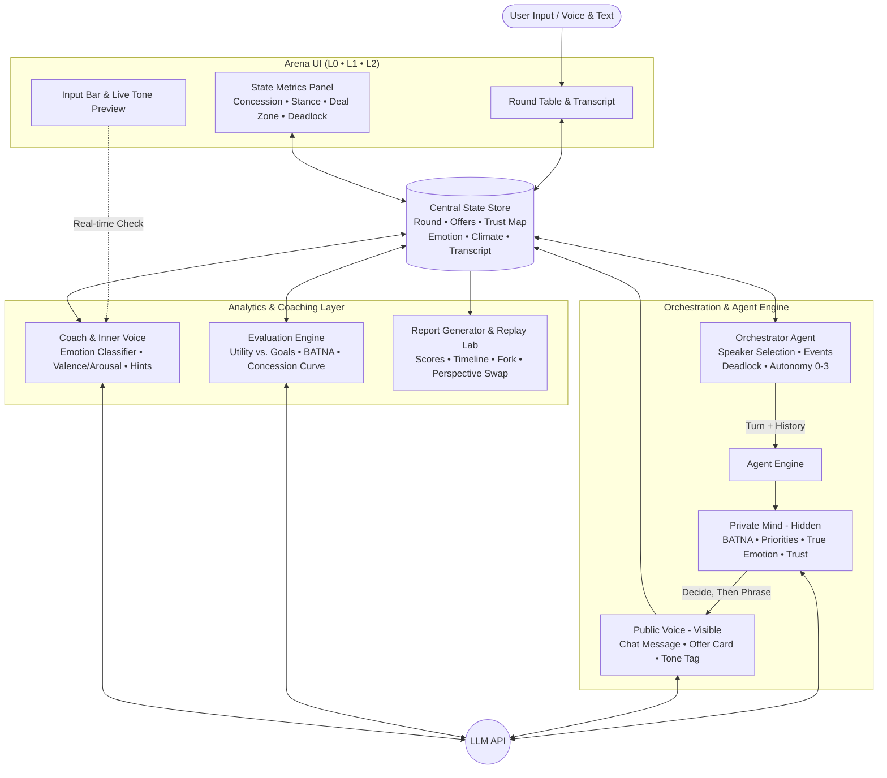
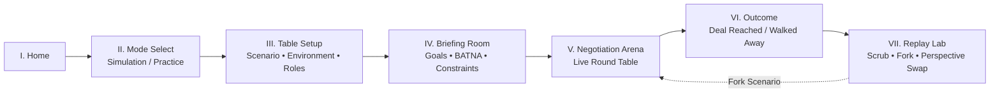
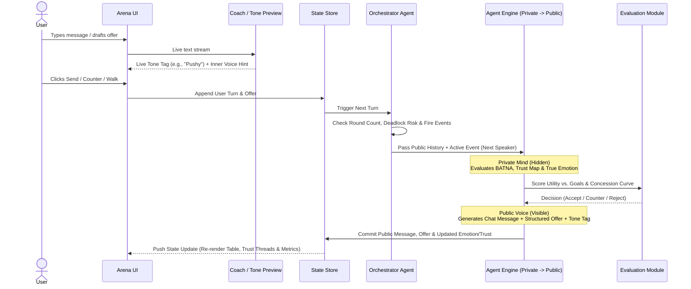

# System Architecture – Multi-Agent Negotiation Simulator

## 1. Overview

The **Multi-Agent Negotiation Simulator** is a Generative-AI powered platform that enables users to either observe autonomous AI agents negotiate (**Simulation Mode**) or participate directly as a negotiating party (**Practice Mode**).

The architecture is anchored by a central **Orchestrator Agent** that manages turn-taking, shared state, environmental dynamics, and deadlock resolution. Each negotiating agent enforces a strict boundary between its **Private Mind** (internal reasoning, hidden BATNA, true emotions) and **Public Voice** (visible chat messages and structured offers).

---

## 2. High-Level System Architecture



---

## 3. End-to-End User Navigation Flow



* **Scenarios:** Vendor Pricing (3-seat, Medium), Project Budget (3-seat, Hard), Job Offer (3-seat, Easy), or Custom (2–5 seats).
* **Environment Controls:** Configurable Ambience/Climate (*Volatile* vs. *Pleasant*), Event Frequency, and **Mind Reveal** toggle.

---

## 4. Turn Lifecycle (Sequence Diagram)

This diagram traces a single negotiation turn from user input to UI state update:



---

## 5. Core Architectural Pillars

### A. Private Mind vs. Public Voice (Information Isolation)
To simulate realistic negotiations, agents never have direct access to another agent's internal state.

| Layer | Visibility | Data Stored / Generated |
| :--- | :--- | :--- |
| **Private Mind** | Hidden (Exposed only via **Mind Reveal** toggle or Replay Lab) | BATNA (walk-away threshold), hidden priorities, true emotion (valence/arousal), pairwise trust map, impact analysis. |
| **Public Voice** | Visible to all agents & user | Chat transcript message, structured offer card (Price, Delivery, Warranty), public tone tag. |

### B. Orchestrator Autonomy Levels (0–3)
* **Level 0 (Passive):** Strict round-robin turn-taking; no interventions.
* **Level 1 (Timekeeper / Auditor):** Tracks round limits, enforces rules, and logs concession metrics.
* **Level 2 (Active Mediator):** Detects rising deadlock risk and injects clarifying prompts or cooling-off cues.
* **Level 3 (Dynamic Director):** Actively fires environmental events (e.g., sudden budget cut, supply delay) based on the configured Event Frequency.

### C. UI Disclosure Layers (L0 – L1 – L2)
* **L0 (Core Table):** Round table avatars, active speaker indicator, central Offer on Table card, and chat transcript.
* **L1 (Visual Intelligence):** Dynamic **Trust Threads** (line thickness/style reflects pairwise trust), **Emotion Orbs** (calm–agitated / negative–positive), and the **Metrics Panel** (Concession Lines, Stance Bars, Deal Zone Overlap %, Deadlock Risk %).
* **L2 (X-Ray / Coaching):** **Mind Reveal** overlay (exposing hidden BATNA & internal feelings), **Inner Voice / Hint Bar**, and **Live Tone Preview**.

---

## 6. Central State Store Contract (Milestone 2 Ready)

This JSON schema defines the contract between the Frontend UI and the Orchestrator/Agent Engine:

```json
{
  "sessionId": "sim_vendor_001",
  "mode": "practice",
  "round": 3,
  "environment": {
    "climate": "volatile",
    "pressure": 0.40,
    "deadlockRisk": 0.35,
    "dealZoneOverlap": 0.55,
    "activeEvent": null
  },
  "offerOnTable": {
    "proposedBy": "agent_supplier",
    "terms": {
      "pricePerUnit": 10000,
      "deliveryDays": 19,
      "warrantyMonths": 12
    },
    "status": "countered"
  },
  "agents": [
    {
      "id": "agent_supplier",
      "role": "Supplier (AI)",
      "stance": "firm",
      "publicEmotion": { "label": "Firm", "valence": -0.2, "arousal": 0.6 },
      "privateMind": {
        "batna": 28000,
        "trueEmotion": "Anxious",
        "hiddenPriority": "deliveryDays"
      }
    }
  ],
  "trustMap": [
    { "from": "agent_supplier", "to": "user", "strength": 0.72 }
  ]
}
```